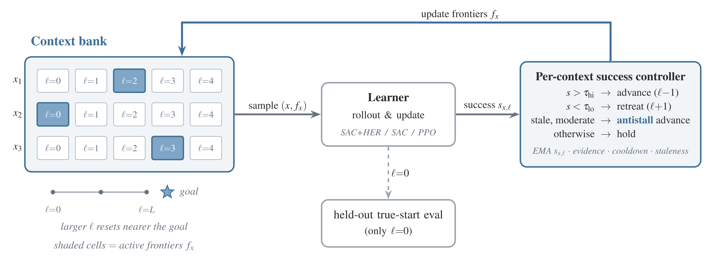

# Per-Context Reverse Curricula for Sparse-Reward Reinforcement Learning

<p align="center">
  <a href="https://arxiv.org/abs/2607.26417"></a>
  &nbsp;
  <a href="https://siddharthaphale.github.io/blog/2026/scout-per-context-scaffolds"></a>
  &nbsp;
  <a href="https://www.robot-learning.ml/2026/"></a>
</p>

Reverse curricula make sparse-reward tasks easier by starting training from assisted states. **PCRC gives each task context its own pace for removing that assistance**, using rollout success to advance, restore support, or try a harder start when progress stalls.

<p align="center">
  
</p>

---

## Install

We use [uv](https://docs.astral.sh/uv/) for reproducible environments. The lock file pins the dependencies; see [`pyproject.toml`](pyproject.toml).

```bash
git clone https://github.com/siddharthaphale/pcrc.git
cd pcrc
uv sync --frozen --extra train --extra robotics --extra eval --extra test
```

**Requirements:** Python 3.10+.

---

## Repository layout

```text
pcrc/
├── src/pcrc/       Controllers, learners, environments, and training loops
├── scripts/        Training entry points and bank/scaffold builders
├── config/         Experiment configurations
├── results/banks/  Context banks and scaffold fixtures
├── tests/          Unit and environment integration tests
└── assets/         README illustration
```

---

## Running experiments

Run from the repository root, with settings in `config/`:

```bash
export MUJOCO_GL=egl
export OMP_NUM_THREADS=1

# 1. PointMaze
uv run --no-sync python scripts/pointmaze_sac_her.py \
    --config config/pointmaze_curriculum.yaml \
    --exp-name pointmaze/s42 --conditions per_context_success,unassisted --seed 42

# 2. MiniGrid DoorKey
uv run --no-sync python scripts/minigrid_ppo.py \
    --config config/minigrid_doorkey.yaml \
    --exp-name doorkey/s42 --conditions per_context_success,unassisted --seed 42

# 3. Fetch pacing conflict
uv run --no-sync python scripts/fetch_sac_her.py \
    --config config/fetch_pick_and_place.yaml \
    --bank-path results/banks/pnp_conflict_bank.json \
    --exp-name fetch_conflict/s42 \
    --conditions per_context_success,global_anneal,unassisted --seed 42

# 4. Meta-World pick-and-place
uv run --no-sync python scripts/metaworld_sac_her.py \
    --config config/metaworld_pickplace.yaml \
    --exp-name metaworld/s42 --conditions per_context_success,unassisted --seed 42
```

For a quick check before a full training run:

```bash
make test-cpu

uv run --no-sync python scripts/minigrid_ppo.py \
    --config config/minigrid_smoke.yaml \
    --exp-name smoke/doorkey --conditions per_context_success,unassisted --seed 42
```

---

## Citation

```bibtex
@misc{aphale2026pcrc,
  title         = {Per-Context Reverse Curricula for Sparse-Reward Reinforcement Learning},
  author        = {Aphale, Siddharth and Singh, Ayushman},
  year          = {2026},
  eprint        = {2607.26417},
  archivePrefix = {arXiv},
  primaryClass  = {cs.LG},
  url           = {https://arxiv.org/abs/2607.26417}
}
```
